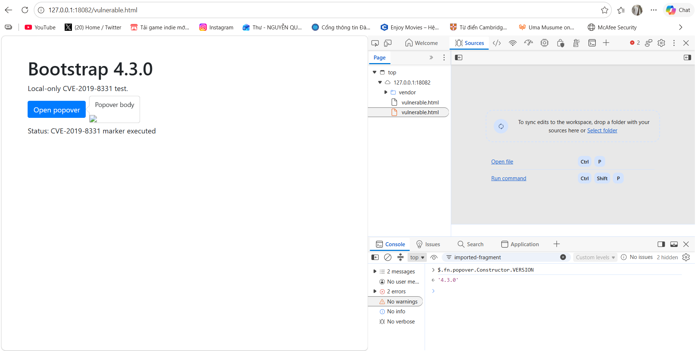
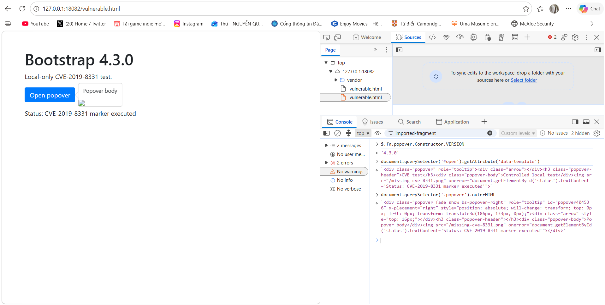

## Overview

CVE-2019-8331 is a cross-site scripting issue in Bootstrap tooltip and popover plugins. In vulnerable releases, HTML supplied through the `data-template` option was not sanitized before Bootstrap created the component DOM. Bootstrap fixed the issue in 3.4.1 and 4.3.1 by adding an HTML sanitizer.

This write-up reproduces the issue locally with Bootstrap 4.3.0 and verifies the same test against 4.3.1. The lab uses a harmless DOM marker; it does not send data to external services or access local files.

## Lab Setup

- Host: Windows PowerShell
- Server: Python HTTP server bound to `127.0.0.1:18082`
- Vulnerable page: `vulnerable.html`
- Fixed page: `fixed.html`
- jQuery: 3.3.1
- Popper.js: 1.14.7
- Bootstrap comparison: 4.3.0 and 4.3.1

The lab deliberately simulates an application that allows an untrusted value to reach the Bootstrap `data-template` attribute. This input condition is required for the demonstrated attack.

## Reproduction Steps

1. Open `http://127.0.0.1:18082/vulnerable.html`.
2. Confirm the version in DevTools Console:

   ```javascript
   $.fn.popover.Constructor.VERSION
   // "4.3.0"
   ```

3. Click **Open popover**.
4. Observe the status marker change to `CVE-2019-8331 marker executed`.
5. Inspect the input and rendered DOM:

   ```javascript
   document.querySelector('#open').getAttribute('data-template')
   document.querySelector('.popover').outerHTML
   ```

## Proof of Concept

The test template contains an image with an `onerror` handler. The image is intentionally missing, so the handler updates a local status element when the popover is rendered. The image request targets only the local lab server.



## Root Cause

The vulnerable page supplies a template containing an event-handler attribute. Bootstrap 4.3.0 copies the template into the generated popover DOM without the sanitizer introduced in the fixed release. The rendered `.popover` therefore retains `onerror`, and the browser executes it when the missing image fails to load.



## Fix Verification

The same template and interaction were tested against Bootstrap 4.3.1. The normal popover still renders, but the local marker remains `Status: not triggered`.


| Test | Bootstrap 4.3.0 | Bootstrap 4.3.1 |
|---|---|---|
| Version reported by plugin | 4.3.0 | 4.3.1 |
| Normal popover | Works | Works |
| Local marker from template event handler | Executed | Not triggered |

## Impact

If an application lets an attacker control `data-template` or an equivalent tooltip/popover template, the attacker may execute JavaScript in the page's origin when a victim triggers the component. The practical impact depends on the application's origin, permissions, and available authenticated actions.

## Limitations

This is a local component-level reproduction. It does not claim that every Bootstrap application is exploitable. A real attack additionally requires an input path that lets attacker-controlled HTML reach the template option and a victim interaction that initializes the tooltip or popover.

## Mitigation

For the versions tested here, Bootstrap 4.3.1 fixes the demonstrated issue. The corresponding Bootstrap 3.x security release is 3.4.1.

Keep sanitizer defaults enabled, avoid passing untrusted HTML as templates, and validate or constrain values that reach tooltip/popover configuration. These historical patch versions address this CVE; they should not be treated as a general recommendation for a current production deployment.

## References

- [Bootstrap security release](https://blog.getbootstrap.com/2019/02/13/bootstrap-4-3-1-and-3-4-1/)
- [NVD: CVE-2019-8331](https://nvd.nist.gov/vuln/detail/CVE-2019-8331)
- [Bootstrap 4.3 JavaScript documentation](https://getbootstrap.com/docs/4.3/getting-started/javascript/)
